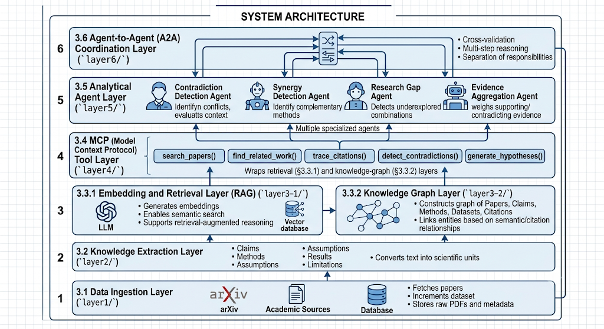

# ProjMnemosyne — AI Research Paper Intelligence System

A modular pipeline that ingests AI research papers, extracts their scientific
content, makes the corpus semantically searchable, builds a knowledge graph,
and runs analytical agents over it to surface contradictions, synergies,
research gaps, and weighed evidence. See [`ref.md`](ref.md) for the concept.

The guiding principle throughout: **code orchestrates, models judge.** Control
flow is deterministic Python; LLMs/embeddings are called only where genuine
judgement is needed, always behind a clear interface with an offline fallback.

## Architecture



Each layer is a self-contained Python package. The folder number matches the
`ref.md` §3 section. Layers depend only on the ones above them.

| Folder | ref.md | Layer | What it does | Output |
|--------|--------|-------|--------------|--------|
| [`layer1/`](layer1/) | §3.1 | Data Ingestion | Fetch + dedupe papers (arXiv / Semantic Scholar / OpenReview), GROBID full text | `storage/metadata.jsonl`, `*.tei.xml` |
| [`layer2/`](layer2/) | §3.2 | Knowledge Extraction | LLM extracts claims / methods / datasets / results / assumptions / limitations | `storage/extracted.jsonl` |
| [`layer3-1/`](layer3-1/) | §3.3.1 | Embedding & Retrieval (RAG) | Embed abstracts + units (Voyage), brute-force cosine search | `storage/vectors.npy`, `chunks.jsonl` |
| [`layer3-2/`](layer3-2/) | §3.3.2 | Knowledge Graph | Papers/Claims/Methods/Datasets/Authors graph with entity resolution | `storage/graph.json` |
| [`layer4/`](layer4/) | §3.4 | MCP Tool Layer | 5 structured tools over L3-1/L3-2, served over real MCP | (stateless) |
| [`layer5/`](layer5/) | §3.5 | Analytical Agents | Contradiction / Synergy / Research-Gap / Evidence agents (workflows) | `storage/findings.jsonl` |
| [`layer6/`](layer6/) | §3.6 | A2A Coordination | Runs all agents on a topic, cross-validates their findings | `storage/reports.jsonl` |
| [`frontend/`](frontend/) | — | Web console | Vue 3 + Vite single-page app (overview dashboard, search/graph/agents/insights views, live analyst control) served by a stdlib HTTP server over Layers 4–6 + the analyst | (serves HTTP) |
| [`pipeline/`](pipeline/) | — | Orchestrator | Runs every layer end-to-end, then launches the frontend | (drives the above) |
| [`analyst/`](analyst/) | — | Autonomous analyst | Self-directed loop: picks targets, runs the agents, banks ranked insights | `storage/insights.jsonl` |
| [`verifier/`](verifier/) | — | Insight verification | Deterministic checks that an insight stands on the corpus; the analyst's gate before banking | `storage/rejected_insights.jsonl` |
| [`evaluation/`](evaluation/) | — | Retrieval evaluation | Offline recall@k / MRR of the vector index (unit → source paper) | (prints a report) |

Data flows **down** the table; every layer reads the append-only JSONL the
previous layers wrote in `storage/`.

## Setup

```bash
python -m venv .venv
.venv\Scripts\activate            # PowerShell: .venv\Scripts\Activate.ps1
pip install -r requirements.txt
```

Dependencies are deliberately minimal: `requests`, `huggingface_hub` (LLM),
`numpy` (vectors), `networkx` (graph), `mcp` (Layer 4 server only),
`python-dotenv` (`.env` loading). No torch, no vector DB, and no web framework
on the **backend** — the console is served by the stdlib `http.server`.

### Frontend (web console)

The console under [`frontend/`](frontend/) is a Vue 3 + Vite single-page app. A
built bundle is committed under `frontend/dist/`, so `python -m frontend` and
`python -m pipeline` serve it as-is — **no Node required to run it**. Only if you
change the UI source do you need to rebuild:

```bash
cd frontend
npm install
npm run build        # regenerates frontend/dist/ that the server serves
```

### API keys (`.env`)

Copy [`.env.example`](.env.example) to `.env` and fill in:

```ini
HF_TOKEN=hf_...          # Layer 2 extraction + Layer 4/5 reasoning (HF Inference)
VOYAGE_API_KEY=pa-...     # Layer 3-1 embeddings / semantic search
S2_API_KEY=               # optional: lifts Semantic Scholar rate limits (Layer 1)
```

Every CLI loads `.env` automatically (shell-set vars take precedence). **No key
is required to try the system**: Layer 3-1 indexing has `--fake-embeddings`,
search falls back to keyword matching, and the reasoning paths fall back to a
clearly-labelled offline stub (`--offline`).

## Running everything at once

The [`pipeline/`](pipeline/) orchestrator runs every build step then launches
the console — the one command to go from corpus to a usable UI:

```bash
python -m pipeline                       # extract -> index -> graph -> serve console
python -m pipeline --ingest 2            # also fetch + ingest 2 papers first (Layer 1)
python -m pipeline --ingest 2 --query arxiv=cat:cs.LG  # ingest on a custom per-source query
python -m pipeline --investigate "chain of thought"   # also run an A2A report
python -m pipeline --no-serve            # build only, don't launch the console
python -m pipeline --offline --fake-embeddings        # no API keys needed
```

It's key-aware: it uses real extraction/embeddings when `HF_TOKEN` /
`VOYAGE_API_KEY` are set and skips or falls back (reusing the on-disk corpus)
otherwise. Build steps run as the individual layer CLIs (you see each one's
output); the frontend is served in-process at the end. Then open
<http://127.0.0.1:8000>.

## Autonomous analysis (hands-off)

The [`analyst/`](analyst/) is the self-directed driver: a slow background loop
that picks its own targets from the knowledge graph, runs the Layer 5 agents,
and banks **ranked** insights — no interaction required. It's the difference
between "a system you query" and "a system that does the analysis on its own".

```bash
python -m analyst run                  # loop forever, slowly (15-min generations)
python -m analyst run --iterations 3   # a few generations, then stop
python -m analyst run --grow 2         # also fetch+process 2 new papers each generation
python -m analyst run --offline        # stub reasoner (no HF_TOKEN)
python -m analyst insights --top 15    # the highest-ranked insights found so far
python -m analyst status               # progress + what it will look at next
```

Each generation it works a small batch of self-generated tasks (per method:
contradiction + evidence probes; plus global synergy + gap probes), dedupes
findings against what it already banked, scores them (confidence + provenance
breadth + real-vs-stub), and appends new ones to `storage/insights.jsonl`. It
saves state after every generation, so Ctrl+C and rerun resumes exactly where
it left off. As the corpus grows, new methods create new tasks automatically.
The frontend console shows the banked insights under the **Insights** view
(served from `/api/insights`).

> The analyst surfaces *real* insights only with a real, focused corpus +
> real reasoning (`HF_TOKEN`). On a tiny corpus it runs correctly but finds
> little — that's a data limitation, not a code one.

### Driving it from the console

The console's **Analyst** view controls the same loop **in-process** — no
terminal needed. It runs the engine on a background thread the server owns, so
you can start / pause / resume / stop it, **fast-forward** the wait to run the
next generation immediately, and watch live progress (phase, generation, tasks,
a countdown to the next run). You can also retune it live: pace (interval,
batch), how many papers to **grow** each generation, the offline toggle, and —
unlike the CLI — **which sources and the per-source search queries** it ingests
from. *New analyst (reset)* archives the current state + insights to
`storage/archive/<timestamp>/` and starts fresh from generation 0. Settings
persist to `storage/analyst_config.json`.

> Run the console **or** the CLI loop, not both at once — they share
> `storage/insights.jsonl` and `storage/analyst_state.json`.

## Running the layers individually

```bash
# L1  ingest papers (metadata always; --ingest N also pulls PDFs through GROBID)
python -m layer1 --sources arxiv --limit 5 --ingest 1
python -m layer1 --sources arxiv --query arxiv=cat:cs.LG --ingest 1   # override a source's query

# L2  extract structured units from the ingested papers
python -m layer2 --limit 5                 # or --dry-run to preview prompts

# L3-1  embed + index (build the vector store)
python -m layer3-1 index                   # or: index --fake-embeddings
python -m layer3-1 search "chain of thought reasoning" --kind claim

# L3-2  build the knowledge graph, then query it
python -m layer3-2 build
python -m layer3-2 stats
python -m layer3-2 query coverage_gaps

# L4  the MCP tools — call directly, or serve over the protocol
python -m layer4 call search_papers '{"query":"chain of thought","k":3}'
python -m layer4 serve                      # exposes the 5 tools to MCP clients

# L5  run an analytical agent (or all of them)
python -m layer5 run contradiction --topic "chain of thought"
python -m layer5 run all --topic "supervised fine-tuning"

# L6  A2A: investigate a topic across all agents + cross-validate
python -m layer6 investigate "chain of thought reasoning"

# Frontend: Vue 3 SPA (dashboard + search/graph/agents/insights + analyst control)
python -m frontend                          # http://127.0.0.1:8000
```

Append `--offline` to the L4/L5/L6/frontend commands to force the stub reasoner
(no `HF_TOKEN` needed). All write-producing steps are idempotent / append-only.

## Evaluation (retrieval quality)

`python -m evaluation` measures how well the Layer 3-1 index finds the right
paper. It is offline (reads `storage/vectors.npy` + `chunks.jsonl`, no API
calls) and deterministic.

**Task: unit → source paper.** Each extracted unit (claim, method, result,
dataset, assumption, limitation) is used as a query against the paper-level
index (`kind="abstract"`) through the store's own `search()`; a query is
correct when its source paper comes back. No hand labels are needed: the
extraction already records which paper each unit came from.

Result on the June 2026 store (voyage-3, 11 indexed papers, 123 units):

| Metric | Score | Random ranking |
|--------|-------|----------------|
| recall@1 | 0.902 | 0.091 |
| recall@5 | 0.967 | 0.455 |
| MRR | 0.935 | 0.275 |

Per kind, claims, methods, results and limitations reach recall@5 = 1.0;
dataset units are the weak spot (recall@5 = 0.727, MRR = 0.583) because a
dataset line such as "NuminaMath-CoT: training and evaluation for mathematical
reasoning" fits several papers equally well.

This offline run has two limits: only 11 candidate papers (a small, easy
pool), and queries reuse document-side embeddings. The live run below removes
both.

### Live run: real query embeddings, larger pool, current models

`python -m evaluation.live` rebuilds the index with any Voyage model in its own
folder (`storage/eval/<model>/`, git-ignored; the committed store is never
touched), using Layer 3-1's own chunking. It embeds each unit as a real search
query (`input_type="query"`, the path `search()` takes), and can add recent
arXiv papers, fetched live through Layer 1's `ArxivFetcher`, as distractors
in the candidate pool:

```bash
python -m evaluation.live --model voyage-3 --model voyage-4 --distractors 100 --json storage/eval/results.json
```

Results, 25 Nov 2026 (123 unit queries; pool = 11 corpus papers + 100 arXiv
cs.CL/cs.LG/cs.AI papers submitted 24 Nov 2026):

| Model | Pool | recall@1 | recall@5 | MRR |
|-------|------|----------|----------|-----|
| voyage-3 | 11 papers | 0.927 | 0.984 | 0.953 |
| voyage-4 | 11 papers | 0.911 | 0.992 | 0.942 |
| voyage-3 | 111 papers | 0.886 | 0.935 | 0.912 |
| voyage-4 | 111 papers | 0.870 | 0.919 | 0.892 |
| random | 111 papers | 0.009 | 0.045 | 0.048 |

Findings:
- Ranking stays strong when the pool grows tenfold: MRR drops from 0.95 to
  0.91 with voyage-3.
- voyage-4 (Jan 2026) does not beat voyage-3 on this task; the gap is 2 of
  123 queries, i.e. a tie. There is no reason to re-index for quality.
- Dataset units are the weak spot (recall@5 0.45 on the 111-paper pool):
  a dataset name with a one-line purpose fits many recent LLM papers. Adding
  the paper title, or the sentence that uses the dataset, to the dataset chunk
  text is the obvious next fix.

Rate limits: without a payment method Voyage allows 3 requests / 10K tokens per
minute; `evaluation.live` paces its requests and saves after every batch, so
an interrupted run resumes where it stopped.

### Insight quality: the verifier

The agents let an LLM judge; until Nov 2026 nothing checked a finding before
the analyst banked it. `verifier/` checks every insight against the corpus it
cites, without an LLM:

- **traceable**: every cited chunk and paper exists, and each quoted statement
  matches the stored text;
- **contradiction**: two different claims from two different papers, not a
  mirrored duplicate of one already banked;
- **synergy**: both methods exist in the corpus and come from different papers
  (same-paper pairs are usually a method and its own component or baseline);
- **evidence**: the supporting/contradicting counts in the summary match the
  cited lists, and a "supported" verdict has more support than contradiction;
- **hypothesis**: every `grounded_in` paper exists and contains the entity it
  is cited for.

Stub (offline) output is flagged as a warning. `python -m verifier --details`
reports on `storage/insights.jsonl`. On the June 2026 bank:

| Kind | Banked | Pass | LLM-made and pass |
|------|--------|------|-------------------|
| evidence | 21 | 21 | 19 |
| synergy | 6 | 2 | 2 |
| hypothesis | 3 | 3 | 3 |
| contradiction | 5 | 2 | 0 |
| **all** | **35** | **28 (80%)** | **24 of 31 (77%)** |

Every real contradiction paired two claims from the same paper (one pair was
banked twice, in both orders), and 4 of 6 synergies joined methods from one
paper. Three changes follow from that:

1. **Gate in the analyst**: each new finding is verified before banking;
   failures go to `storage/rejected_insights.jsonl` with their reasons and are
   not retried (`ANALYST_VERIFY=0` turns the gate off).
2. **Contradiction candidates span papers**: `detect_contradictions` now
   over-fetches and interleaves claims by paper before asking the LLM, and
   drops same-paper pairs it returns.
3. **Methods know their paper**: graph Method nodes now resolve their paper
   through INTRODUCES/USES edges (18 of 18, was 0), and the synergy agent
   skips same-paper pairs.

Limit: the verifier proves an insight is traceable and well-formed, not that
the judgement is wise. One banked hypothesis applies a diffusion timestep trick
to chain-of-thought prompting; it passes because every entity it cites exists.
Judging that needs a reviewer, human or LLM.

Tests: `python -m unittest discover tests`.

## Connecting Layer 4 to an MCP client

`python -m layer4 serve` speaks the Model Context Protocol over stdio. Point any
MCP client (Claude Desktop, the Agent SDK, etc.) at it:

```json
{ "command": "/path/to/.venv/Scripts/python.exe", "args": ["-m", "layer4", "serve"] }
```

## Conventions (all layers)

- Plain dataclasses, a `Config` class, a `python -m <layer>` CLI, logging, and
  heavy educational comments.
- Append-only JSONL sinks under `storage/`; re-runs skip work already done.
- Hyphenated packages (`layer3-1`, `layer3-2`) are reached via `importlib`
  (a normal `import` can't name them); `python -m layer3-1` still works.
- Windows consoles are reconfigured to UTF-8 so paper text prints.
